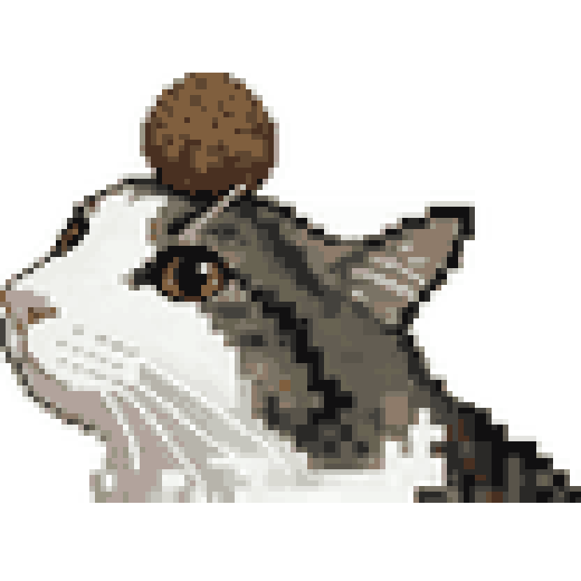
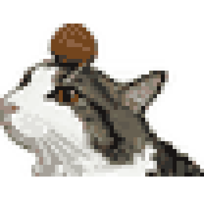
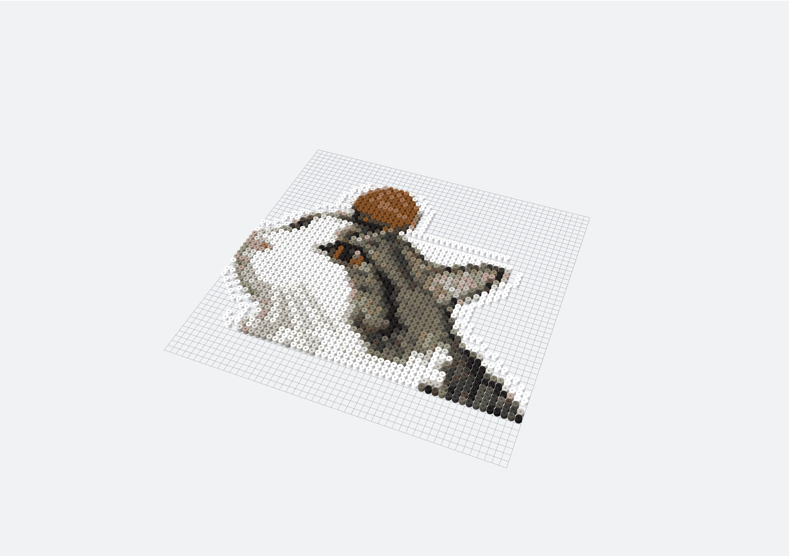
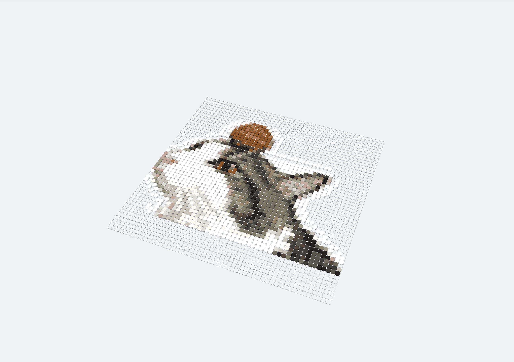
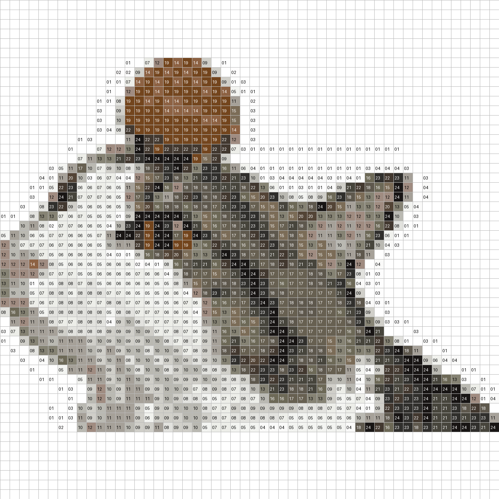

# Image to Perler · Bead Workshop

**Turn your favorite images into bead patterns you can edit, preview, and save.**

Image to Perler is an open-source tool that runs locally. Import an image, choose a brand palette and pattern dimensions, and generate a bead pattern. Refine the details with brushes, selections, and fill tools, check material quantities, and export the pattern for assembly.

The workbench builds into a single HTML file that opens directly in a browser, even offline. Image processing and editing happen on your device, with no account required and no need to upload images to a server.

[中文文档](README.md) · [Usage and development](docs/development.md) · [Palette sources](docs/palette-provenance.md) · [Verification record](docs/implementation-review.md)

## From a cat photo to a bead pattern

| Original photo | Pixel-art source | Bead preview |
| --- | --- | --- |
|  |  |  |

The maintainer provided the photo. The pixel-art source was redrawn with Seedream using the photo as a reference, given a transparent background, and then converted to bead grids. **AI redrawing is a separate preparation step, not an automatic converter feature.** These examples use generic color IDs to illustrate the workflow, not brand-palette mapping. The 3D comparison below contains actual rendering screenshots from the new workbench. See [source and generation details](examples/cat/README.md).

### One source, different sizes

| 36×36 cells · 671 beads | 52×52 cells · 1,353 beads | 104×104 cells · 4,976 beads |
| --- | --- | --- |
|  |  |  |

All three variants use 24 colors. Larger grids generally preserve more detail and require more beads. Previews are displayed at equal widths to compare detail, not physical dimensions.

### 3D and melting appearance comparison

| 3D bead preview · melt level 0 | Melting appearance · melt level 100 |
| --- | --- |
|  |  |

These screenshots capture the actual Three.js canvas after importing the same 52×52 example into the new workbench. Both retain the same camera angle, colors, and 1,353 beads; only the melt level changes to show differences in bead holes and thickness. This is a visual simulation, not a prediction of actual ironing results.

### Final pattern and material list

The numbered pattern below is rendered from the actual 52×52 example grid. Numbers correspond to generic IDs C01–C24; blank cells contain no bead. Click the image for the full-size view.

[](examples/cat/generated/board-52/pattern-grid.png)

[Download grid CSV](examples/cat/generated/board-52/grid.csv) · [View bead usage](examples/cat/generated/board-52/usage.csv)

## About the project

Turning an image into a finished bead piece often requires adjusting colors, refining outlines, counting beads, and tracking assembly progress. Image to Perler brings these steps into one workbench so generated patterns remain editable and useful throughout the process.

It is designed for:

- **Bead hobbyists** who want to convert pixel art, illustrations, or photos into patterns and refine them before assembly.
- **Pattern creators** who need to edit parts of a design, switch brand palettes, and export patterns and material lists.
- **Developers and AI tool users** who want to extend the open-source code or use the Trae Skill to help create patterns.

Photos can be resized and reduced to a limited palette, but this does not automatically produce polished pixel art or perform general-purpose background removal. Images with clear outlines and simple backgrounds are usually easier to work with.

## Features

| Feature | Description |
| --- | --- |
| Image conversion | Set width, height, brand palette, and maximum color count to generate a bead grid |
| Transparency | Transparent cells mean no bead; opaque white remains a valid bead color |
| Basic editing | Brush, eraser, fill, color picker, replace matching colors, and Shift straight lines |
| Selection editing | Rectangle and lasso selections with move, fill, and delete operations |
| Pattern adjustments | Horizontal/vertical flips, 90° rotation, canvas resizing, and isolated-bead removal |
| Palette remapping | Map an existing pattern to another palette using nearest RGB colors |
| Assembly tools | Color-code labels, color filtering, usage counts, and per-cell completion marks |
| 3D preview and editing | Rotate and zoom the bead model, and edit cells in the 3D view |
| Melting appearance preview | Adjust hole size, thickness, and outer diameter for an approximate fused appearance |
| Save and export | Project JSON, offline HTML with the project, PNG, usage CSV, and printing |
| Undo and recovery | Undo/redo and explicit restoration of a local draft |

Selections are created and moved in the 2D view. The melting preview is a visual approximation; it does not predict temperatures, ironing times, or physical material fusion.

## Quick start

Install **Node.js 24**, then run:

```bash
git clone https://github.com/BianQue/image-to-perler.git
cd image-to-perler
npm ci
npm run build
```

After building, open `dist/index.html` directly in your browser.

Installing dependencies requires an internet connection. The built workbench works offline. The 3D features require a browser with WebGL support.

## Create a pattern from an image

1. Set the pattern width, height, brand palette, and maximum color count.
2. Click the image import and conversion button to select a local image.
3. Refine the pattern with brushes, fills, or selection tools.
4. Review color usage and switch to the 3D view as needed.
5. Save a Project JSON file and export PNG, CSV, or offline HTML.
6. Use completion marks to track assembled cells while making the piece.

Images are scaled to the specified width and height. To avoid distortion, preserve the original aspect ratio or crop the image first.

## Save your work

**Use Project JSON for long-term storage.**

A project file stores pattern dimensions, the palette, cell color IDs, empty cells, and assembly progress. Reopen it later to continue editing.

- **Project JSON**: Save your work and continue editing later.
- **Offline HTML**: Includes the workbench and a snapshot of the current project for opening on another computer.
- **PNG**: View, share, or print the pattern.
- **CSV**: Check color IDs and bead quantities.
- **Local draft**: Temporary recovery, not a replacement for a downloaded project file.

Physical board size controls grid divisions without changing global cell coordinates.

## Brand palettes and colors

The workbench includes **12 palettes with 1,315 color entries** from `beadcolors`, covering series from Artkal, Hama, Perler, Nabbi, and Yant.

These community-collected screen colors are not manufacturer-certified. Displays, physical bead batches, and ironing can affect the final appearance. Check physical color charts before buying materials.

You can import JSON palettes that you have compiled or have permission to use.

See [palette provenance](docs/palette-provenance.md) for sources, licenses, and the import format.

## Use with Trae

The repository provides [SKILL.md](SKILL.md) for use as a Trae Skill. Place the repository in your project's `.trae/skills/image-to-perler` directory, or the personal skills directory supported by your Trae version, and enable it accordingly.

Example prompt:

```text
Use image-to-perler to turn this image into a 52×52 bead pattern.
Use the Perler Midi palette with at most 16 colors.
Preserve transparent areas and export an editable project,
offline HTML, and a bead usage list.
```

Explicitly request AI redrawing if you need it. Image conversion itself performs resizing and palette mapping; it is not AI pixel-art redrawing.

## Development and verification

Built with **TypeScript · Vite · Three.js · Vitest**.

```bash
npm run dev        # Start the development server
npm run typecheck  # Check types
npm test           # Run core behavior tests
npm run build      # Build the single-file offline workbench
```

Verification includes core tests and Chromium checks for local-file opening, offline save/reopen, selected 2D/3D editing operations, and exports. See the [verification record](docs/implementation-review.md) for coverage and remaining gaps.

Issues and improvement suggestions are welcome. See the [contribution guide](CONTRIBUTING.md) to get involved.

## License

Project code is licensed under the [MIT License](LICENSE).

Third-party palettes and dependencies retain their own copyrights and licenses. See the [cat example documentation](examples/cat/README.md) for its image permission statement. When creating or sharing patterns from other images, make sure you have the appropriate rights to use them.
