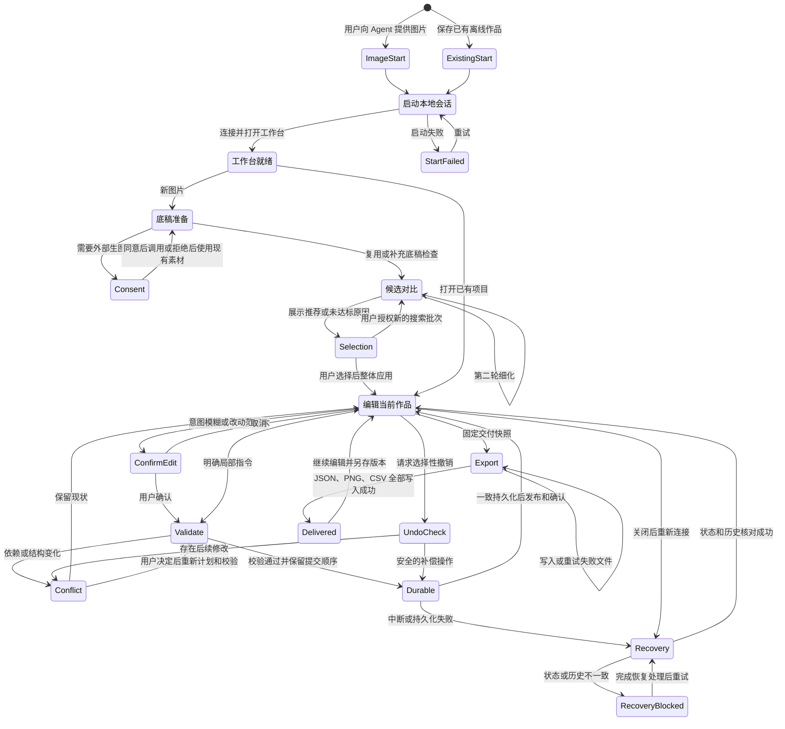

# Agent 协作设计与可行性核查

日期：2026-11-11；2026-11-13 记录已接受的设计基线，实现仍待后续 PR。

**本地协作、冲突处理、选择性撤销和跨重启恢复均为设计目标，目前尚未实现。** 本文和附带模型不改变现有工作台行为。

目标是让用户与 Agent 在同一份作品上协作。Agent 准备素材、提出候选并执行编辑，用户保留确认和撤销权。

已用 TLA+（状态规范语言）和 TLC（模型检查器）检查有限实例。详见 [状态图、模型、反例和复现方法](formal/README.md)。模型通过不代表应用实现已经通过验收。

## 本次基线范围（V1 / V2 校正）

本 PR 记录已接受的设计、形式模型及审计材料，不包含运行时源码、不启用功能，也不代表历史设计分支的全部内容。[历史 PR 1](https://github.com/BianQue/image-to-perler/pull/1) 包含 advisory 源码和测试，继续保持 OPEN / draft、不合并；这些源码仍未合入，安排在后续实现 PR。本文中源码能力描述以 pinned head 为观察基线，不表示本 PR 带入了该源码。

实际库存为 **7 个 TLA 模块、90 个 cfg 文件、95 个 evidence 文件**；可重跑的清单与计数命令见 [形式模型索引](formal/README.md#完整库存与本次基线范围)。已接受的默认政策、阶段计划和有限检查边界见 [审计索引](reviews/2026-11-13-pr1-baseline/README.md)，操作入口与记录要求见 [记录契约](operation-record-contract.md)。历史文档中的待决选项以该默认政策为准。

## 评审入口与首版边界

首版面向具备本地命令和文件能力的 Agent。Skill 提供制作流程，本地服务连接工作台，Agent 环境提供可选生图工具。

首版包括候选比较、批量编辑、冲突提示、选择性撤销、本地历史恢复和文件交付。普通用户继续使用离线 HTML。

首版不包含云端多人协作、内置模型账户或计费。纯网页聊天平台适配、自动接管离线标签页也不在首版范围。评分标准和候选搜索规则需要真实案例校准。

评审重点是状态所有权、持久化顺序和结构变换后的撤销范围。合并本文仅记录设计，不启用功能或承诺发布时间。

## 目标流程状态图

这张图覆盖产品入口、候选确认、编辑、恢复和交付。连接、恢复失败和冲突决策是设计目标，未全部纳入有限模型。模型的全部动作见 [动作表](formal/README.md#完整模型动作表)。

## 已确认的产品范围

- 保留单文件 HTML 离线使用；协作模式由具备本地命令与文件能力的 Agent 启动本地服务。首版不承担纯网页聊天平台的接入适配。
- 支持两种协作入口：已有离线作品先保存，再到协作工作台打开；新作品由用户直接向 Agent 提供图片和要求发起，无需先手动打开工作台。
- Skill 提供制作方法和工具使用说明；Agent 环境提供生图能力，项目不绑定生图供应商。外发照片前告知并取得同意，再次生图前确认。
- Agent 尽可能完成素材准备、转换、检查和交付。人和 Agent 操作同一当前项目，修改在工作台同步展示。
- 明确的局部指令直接执行；模糊意图或大范围修改先确认方案。关键特征由 Agent 识别，仅重大不确定项询问用户。
- 尊重用户约束；已有项目沿用色板，新项目未指定时采用 Artkal C。此选择不是市场占有率排名结论。
- 默认自动选择颜色数量，不固定为 24 色。同一对比组固定底稿和品牌色板；颜色预算可以作为候选变量，但必须标明。
- 未指定尺寸时最多两轮比较：先粗选尺寸，再在不达标与达标的区间细化并调整色数。推荐已评审候选中的最小达标尺寸，再在该尺寸内减少颜色；不声称全局最优。
- 评分：每个候选先由确定性的筛选器（`screen`，见历史 PR 1 的 `src/advisory/`）逐个算出排序分并给出提示，只做建议，不阻断用户。它每次都运行，推荐在最佳分 10 分内豆数最少的候选，折叠明显较差的候选但仍可选择；全部带警告时整组标为偏弱，不推荐任何一个。它不识别具体特征，首版不做瞳孔、鼻子等局部检查。Agent 只对最后 1 至 3 个入围候选做可解释评审：主体辨识度 40、轮廓姿态 30、关键特征 30，推荐门槛 80，明确要求保留的特征丢失时不能推荐。80 分和筛选器阈值都是临时值，只在两张图上定过，未经验证，筛选器也尚未接入搜索流程。分数是可解释评审，不是客观精度。
- 复用已有底稿评审；底稿或要求改变时补查，多尺寸图纸统一评审，异常特征才回查原图。未达标先定位原因，超出搜索预算后由用户决定继续或接受不足。
- 候选试算不修改当前作品；确认后整体应用，一次修改意图对应一个普通撤销步骤。
- 用户新修改优先。有冲突时暂停受影响的操作并询问。无冲突操作仅在独立且保持项目有效时继续。
- 普通撤销按时间顺序；指定撤销 Agent 某次修改时保留后续人工编辑，冲突交由用户决定。选择性撤销属于首版能力。
- 协作项目在本地持久保存操作历史，关闭工作台或重启服务后仍可识别并尝试撤销此前的 Agent 修改。导出的 Project JSON 独立可用，不要求携带协作历史；仅凭导出的 JSON 不能恢复原协作记录。
- 默认交付项目 JSON、预览 PNG、用量 CSV。修改后另存版本，确认文件写入成功后才报告完成；独立 HTML 和打印产物按需。

颜色预算的产品比较见 [调研记录](color-budget-research.md)。同类产品实践仅供参考，不证明某个默认值最优。量化前的通用整图预处理见 [离线对比](image-preprocess-research.md)，仅在两张图上评审过，尚未实现。

## 当前实现与差距

| 源码位置 | 已有能力 | 缺口 |
| --- | --- | --- |
| `src/core.ts` | Project v1 校验、不可变编辑、量化、用量和 CSV | 无会话身份、修订号、操作来源或冲突协议 |
| `src/main.ts` 的 `commit` | 提交后更新草稿、2D 和 3D | 状态为页面私有变量，无外部命令入口 |
| `apply`、选区移动、`finishStroke` | 连续笔画最终作为一次提交 | 笔画中途直接修改页面状态，不能同时提交远程修改 |
| `past`、`future`、撤销按钮 | 最多 50 份历史快照 | 无操作 ID、作者和字段修改记录，不能选择性撤销 |
| 图片导入处理器、`quantize` | 浏览器解码缩放后调用独立量化函数 | 候选生成与安装绑定；无多方案评审流程 |
| `download`、保存按钮 | 生成浏览器下载 | 无法确认实际落盘；JSON、PNG、CSV 未绑定同一修订 |
| `package.json`、`vite.config.ts` | Vite 开发服务与离线单文件构建 | 开发服务不是协作协议，无会话管理和交付服务 |
| `tests/core.test.ts` | 编辑、格式边界、量化、CSV 测试 | 无并发、重试、会话断线、撤销历史或文件交付测试 |

`quantize` 按用量选择高频色，可能丢弃少量关键特征颜色；“自动选择颜色”需要评审实际结果，不能仅提高颜色上限就宣称保留特征。当前尺寸上限为 256 格，搜索必须遵守此边界和用户要求。

## 建议的最小技术方案

### 单一状态所有者

先将页面编辑状态及提交入口提取为共享会话模块，人和 Agent 都通过该模块提交。首版建议浏览器工作台作为活动项目的唯一写入者，本地服务负责命令转发、连接与文件交付，避免服务端和页面分别维护可写副本。

本地命令行客户端通过 HTTP 请求服务。服务通过持久连接向工作台转发命令。

成功响应须等待项目状态、操作历史和操作 ID 一致持久化，再由工作台发布已提交状态。入队回执和临时预览均不能表示保存成功。具体事务协议尚待验证。

连接须明确会话 ID 和项目身份。多个标签页不能自动选第一个。

双击打开的离线 HTML 不自动接管。维护者已接受先显式保存，再到本地服务提供的协作工作台打开项目的首次转移步骤。

新作品也可由用户直接向 Agent 提供图片和要求发起，Agent 启动服务并建立协作会话，无需用户预先运行工作台。会话建立后即打开工作台，在工作台展示候选对比，用户通过对话确认后才应用为当前作品；候选预览不覆盖当前编辑内容。外部生图仍遵循已有授权规则。

### 批量修改与并发

每个命令携带会话/项目身份、操作 ID、基础修订、读取依赖、写入集合和预期旧值。重试相同操作 ID 返回已有结果，避免重复修改。

不要仅以整份项目修订变化判冲突：用户修改无关区域可兼容。但也不能只检查将写入的格子；填充范围等结果依赖邻接内容，读取依赖发生变化也需要重新计算或确认。

用户正在画线、拖选区或绘制 3D 笔画时，远程提交等待笔画结束，再重新校验。通过校验的同一修改意图一次提交、一次渲染并生成历史记录。全局操作（旋转、缩放、换色板、替换项目）作为结构事务，不能随意拆成独立成功的局部修改。

从版本校验到持久化完成，提交顺序必须保持不变。人工提交也经过同一队列，避免在校验后插入修改。笔画可以保留临时预览，但须区分“预览中”和“已保存”。

### 选择性撤销

保留普通时间顺序撤销，并记录操作来源、前后值、依赖及变更版本。选择性撤销生成新的补偿操作，不删除中间人工历史。

对同一坐标体系内的局部操作，恢复尚未被后续操作接触的字段；冲突内容先展示。颜色与制作进度存在联动，应作为一致性单元处理。仅比较当前值与旧操作结果不够：用户可能修改后又改回相同值，需要变更记录识别这种情况。

旋转、裁剪、色板替换后的恢复需要坐标映射与依赖分析。首版可将无法证明安全恢复的内容标为冲突并提供候选恢复预览，不静默覆盖或声称已成功撤销。预览只保存在方案覆盖层中，不得追加持久日志，也不得改当前作品状态；接受时必须按当前日志前缀重新推导补偿，不得把旧前缀上算出的补偿直接应用。普通撤销、重做和补偿操作必须共用记录模型。

协作历史与通用 Project JSON 分开保存，包含恢复对应项目状态所需的身份、版本与操作记录。重新连接时必须核对状态和历史一致性，不能把同名文件自动当作原协作项目。操作在页面应用、服务持久化和响应返回之间中断的恢复顺序，需要通过故障测试确定；显示已应用与确认已持久保存应有明确区别。

### 候选与文件交付

复用 `quantize` 和现有校验，候选独立保存；图像解码、预览渲染从“安装当前项目”中分离。Skill/Agent 执行视觉评审，确定性工具计算实际用色数和用豆数，不在量化函数中虚构语义评分。

JSON、PNG、CSV 从同一不可变修订生成。交付回执标明快照修订，不能暗示包含导出期间的新编辑。

服务仅写用户指定输出目录。文件另存新版本，全部成功后返回路径、修订和校验信息。文件写入失败时列出已写文件，并支持安全重试。

## 隐私与本地访问边界

离线模式继续在本机处理图片。协作模式的项目和操作历史也保存在本机。

Agent 所在环境可能使用远程模型。该环境读取的图片、预览或项目数据，也可能发往模型供应商。因此，协作模式不能承诺所有数据都不离开本机。外发前需说明接收方、内容和目的，并取得用户同意。

外部生图为可选步骤，每次重绘前确认。用户拒绝后可继续处理现有素材。Skill 不保存供应商密钥，也不绕过 Agent 环境的权限控制。

本地服务仅监听回环地址，使用会话凭据并校验来源、请求大小和路径。接口仅接受结构化作品操作，不提供任意代码执行或任意文件写入。具体实现需对照所选运行时官方文档验证。

本地历史可能包含旧版本作品内容。导出 JSON 不携带完整历史。检查点之后如何收旧前缀、以及恢复备份时如何避免与现场日志分叉，见 [检查点之后收旧日志与备份恢复的协议验证](log-backup.md)。历史目录怎么放、保留多久，以及压缩后被丢掉前缀里的操作还能不能做选择性撤销、人能不能明确用备份整份替换现有项目，仍待评审。源码和公开日志不得包含用户素材、密钥或个人路径。

## 建议实施顺序与验收

1. 提取会话与操作记录，保留现有编辑表现。验证局部修改、笔画、普通撤销和重做。
2. 验证选择性撤销：保留无关人工修改；识别同格冲突、改回原值、制作标记变化和结构变换。
3. 接入本地服务与客户端并持久保存协作历史。验证两端同步、活动笔画、重复请求、断线响应、错误会话、标签页切换、重启恢复及状态与历史一致性。
4. 分离候选流程与导出。验证试算不改当前作品，三种交付文件一致、失败不误报完成、重试不覆盖旧版。
5. 更新 Skill 与使用说明，用真实图片校准两轮搜索和评分，再验收离线构建、浏览器与下载行为。

## 结论与待验证事项

静态结构支持该方向，无需重写量化和项目格式；主要工程量在会话状态、操作历史和可靠交付。会话元数据建议先与 Project v1 分离，避免无必要的文件格式迁移。

尚待验证：连接协议与浏览器生命周期、历史记录跨重启恢复的一致性、结构操作的恢复范围、候选数量与耗时、评分一致性，以及两个入口的实际体验。已有离线作品先保存再打开、图片直接发起时建立会话即展示工作台，以及本地协作历史跨重启保留，均已获接受。本轮未运行测试或原型，不将这些建议视为已验证架构。

## 模型结论与评审问题

最初的 Collaboration 与 Workflow 两个独立有限模型的正常配置合计检查了 1,088 个不同状态，3 个变异配置均找到预期反例；这只是原始两模型的历史结果，不是完整库存或本次复验总数。完整库存是 7 个 TLA 模块、90 个 cfg 文件、95 个 evidence 文件。各扩展模型的范围和历史运行分别见形式索引，不累加重叠状态空间。

模型要求一致持久化、提交串行化、按版本撤销和固定交付快照。这些要求已写入上文。模型将原子存储作为假设，并未证明具体存储方案具备此能力。

贡献者可优先讨论：

1. 浏览器作为活动项目唯一写入者时，如何实现服务持久化与断线恢复？ 见新增 [协议草案与恢复顺序](single-writer-recovery.md)。
2. 旋转、裁剪或换色板后，首版能够安全恢复哪些操作？ 见新增 [选择性撤销的恢复范围与验证](selective-undo-after-transform.md)。预览方案过期后如何接受，见新增 [预览后由人选择的协议验证](preview-accept.md)。
3. 操作历史如何保留、清理和备份？多个标签页如何识别活动会话？ 保留、清理和备份的协议检查见新增 [检查点之后收旧日志与备份恢复的协议验证](log-backup.md)。多个标签页如何识别活动会话，仍见 [单写入者协议草案](single-writer-recovery.md)。
4. 两轮搜索的候选数量和耗时是否可接受？80 分是否符合真实制作效果？
   讨论结论：两轮计算量可接受，瓶颈在逐张评审，已改由 [历史设计草稿的候选初筛](https://github.com/BianQue/image-to-perler/tree/bdc9c0adc8f0be4b329bf43b7babdae45693cae7/src/advisory) 完成。初筛必须运行但不做决定。80 分不验证真实效果，只作入围复看的临时门槛。

进入正式评审前，需要明确原型验收范围和上述技术假设的验证责任。本基线不带入运行时代码；历史 PR 1 已有的 advisory 源码及后续存储实现和协议接入由后续实现 PR 提交。
