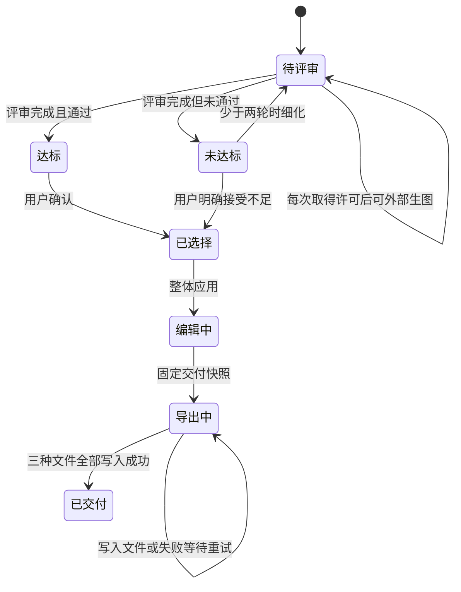
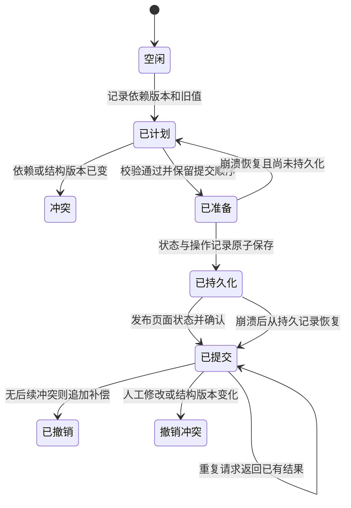

# Agent 协作状态机与有限状态验证

2026-11-11；对应 [产品设计](../agent-collaboration-design.md)。使用 TLA+ 描述状态和转移，实际运行 TLC 检查有限模型的全部可达状态。不是对尚未实现的应用代码作正确性证明，也不是无限规模的定理证明。

## 流程状态图

下面是两个模型的可读投影，完整转移以 `.tla` 文件为准。为便于阅读，未逐一绘出不改变状态的等待及同一阶段中的人工编辑。



图纸评审将“评分达到 80 且关键特征保留”抽象为通过/未通过。模型不计算审美分数。两轮用尽且未接受时留在未达标状态等待；继续搜索属于新的用户授权批次，未建模。



“已准备”至提交完成期间，不允许其他提交插入。实际实现可以使用串行队列或等价的事务机制，不要求锁住整个 UI；尚未提交的笔画应明确为临时预览。

## 完整模型动作表

状态图按阶段展示流程，不展开 1,088 个状态节点。下表列出正常模型和变异模型的全部动作，包括图中省略的自循环。精确变量、守卫和赋值分别见 [Collaboration.tla](Collaboration.tla) 与 [Workflow.tla](Workflow.tla)。

### 协作模型

| 动作 | 起点与条件 | 结果 |
| --- | --- | --- |
| `Plan` | `idle` | `planned`，记录版本、旧值和结构版本 |
| `Human` | `idle/planned/committed`，人工操作少于 2 次 | 当前阶段不变，修改任选豆格并持久化 |
| `StructuralChange` | `planned/committed`，结构尚未变化 | 当前阶段不变，结构版本增加 |
| `Prepare` | `planned`，依赖版本和结构版本一致 | `prepared`，开始保留提交顺序 |
| `Reject` | `planned`，版本不一致 | `conflict` |
| `Persist` | `prepared` | `persisted`，原子保存状态和操作记录 |
| `Publish` | `persisted` | `committed`，发布页面状态并确认 |
| `CrashRecover` | 任意阶段，尚未模拟崩溃 | 页面恢复持久状态；`prepared` 回到 `planned`，`persisted` 进入 `committed`，其余阶段保持 |
| `Retry` | `committed` 且操作已持久化 | 当前阶段不变，返回确认，不重复写入 |
| `Undo` | `committed`，版本和结构未冲突 | `undone`，保存补偿操作 |
| `UndoConflict` | `committed`，撤销前提不成立 | `undoConflict` |
| `EarlyAck` | 仅变异配置，`prepared` | 尚未持久化即确认，触发反例 |

`StaleCommit.cfg` 放宽 `Prepare` 的版本守卫。`ValueUndo.cfg` 将 `Undo` 的版本守卫替换为颜色值比较。两者均预期触发反例。

### 工作流模型

| 动作 | 起点与条件 | 结果 |
| --- | --- | --- |
| `Consent` | 任意阶段，当前无外发许可 | 取得单次许可，阶段不变 |
| `Generate` | `ready`，有许可且生图次数少于 2 次 | 消耗许可并累计调用次数，阶段不变 |
| `Evaluate` | `ready`，评审次数少于 2 次 | 增加次数，进入 `passed` 或 `failed` |
| `Refine` | `failed`，尚未达到 2 次 | 回到 `ready` |
| `Accept` | `passed/failed` | `selected`，记录确认；未达标时记录接受不足 |
| `Apply` | `selected` 且已确认，尚未应用 | `editing`，安装候选 |
| `Export` | `editing` | `exporting`，固定交付快照 |
| `Human` | `editing/exporting`，当前版本小于 2 | 增加当前版本，交付快照不变 |
| `WriteFile` | `exporting`，存在未写文件 | 写入任选文件，阶段不变 |
| `Report` | `exporting`，3 个文件均对应快照 | `delivered`，报告完成 |

两个 `Spec` 都允许等待，即状态不变。冲突解决、拒绝候选、主动取消和超预算继续搜索没有细化为模型动作，不能据此声称这些流程已被验证。模型将达标判断作为外部输入。

## 模型边界

| 模型 | 有限范围 | 抽象假设 |
| --- | --- | --- |
| `Collaboration.tla` | 2 个豆格、2 种值、1 次 Agent 操作、最多 2 次人工编辑、1 次结构变化、1 次崩溃恢复、1 次选择性撤销 | 操作读取/修改第 1 格，第 2 格独立；状态、历史和操作身份原子持久化；结构变化以版本失效表示 |
| `Workflow.tla` | 2 轮评审、最多 2 次外部生图、1 次候选应用、3 种文件、导出期间 1 次人工编辑 | 评审结果外部提供；单文件写入原子且成功后有回执；失败可表现为等待，没有文件系统内容损坏模型 |

人工提交和补偿撤销暂抽象成原子持久化动作，只有 Agent 原始提交拆成持久化/发布阶段。模型没有证实真实存储实现满足这些假设。

两个模型独立检查，不构成两者组合或分布式实现的证明。没有覆盖多个 Agent 操作、完整撤销重做栈、任意依赖图、部分冲突合并、身份认证、过期标签页、路径安全或网络协议。颜色与完成状态联动尚未分别建模。

## 已检查的性质

- `NoSilentOverwrite`：通过提交及选择性撤销时，第 1 格和结构版本必须仍符合前提。监测变量 `bad` 记录任何违反。
- `AcknowledgedIsDurable`：操作确认成功蕴含其持久记录存在。
- `ConsistentPublishedState`：除已持久化尚未发布的过渡阶段，页面与持久状态一致。
- `TypeOK`：协作模型的格子、版本和人工操作次数不越界。
- `BoundedSearch`：自动评审不超过两轮。
- `ConfirmedApply`：候选应用之前有用户确认。
- `PreviewIsIsolated`：候选评审和选择阶段不写当前作品。
- `ConsistentDelivery`：各交付文件对应同一个固定快照，即使导出期间人工继续编辑。
- `NoFalseCompletion`：三种文件未全部成功时不能报告完成。

生图许可在 `Generate` 动作中作为前置条件并在使用后消耗；尚未单独通过变异实验检验该规则。

## 实测结果

工具：官方 TLA+ v1.7.4 分发包，TLC 报告版本 2.19；Java 21；单 worker 广度优先搜索。

| 配置 | 不同状态 | 最大搜索深度 | 结果 |
| --- | ---: | ---: | --- |
| Collaboration | 332 | 10 | 全部列出的不变量通过，队列耗尽 |
| Workflow | 756 | 17 | 全部列出的不变量通过，队列耗尽 |
| EarlyAck | 30 | 4 | 如预期违反持久化确认性质 |
| ValueUndo | 228 | 8 | 如预期违反无静默覆盖性质 |
| StaleCommit | 21 | 4 | 如预期违反无静默覆盖性质 |

反例配置在首个错误处停止，状态数不代表其全部可达状态。

3 个反例的最短动作序列：

1. `EarlyAck`：计划 → 准备 → 提前确认。尚未持久化即报告成功。
2. `ValueUndo`：计划 → 准备 → 持久化 → 发布 → 用户改同格 → 用户改回 → 仅按颜色相等撤销。颜色虽然相同，仍覆盖了后续人工意图。
3. `StaleCommit`：计划 → 用户改第 1 格 → 使用过期计划准备提交。

这些反例来自故意削弱保护的模型，不是发现了已实现应用中的三处缺陷。

## 设计需要补充的约束

以下约束是模型通过验证的前提，已纳入设计文档。约束仍需后续代码满足：

1. 页面可以展示临时预览，但成功确认必须晚于状态、历史和操作身份的一致持久化。
2. 版本校验与持久化之间必须保留提交顺序，避免检查之后又被人工修改。
3. 选择性撤销依据变更版本而非仅当前颜色；结构变化无法安全映射时报告冲突。
4. 导出启动时固定快照；报告具体导出版本，不暗示快照包含导出期间发生的后续编辑。

没有设置公平性条件，也关闭了终止状态的死锁检查。因此这里只验证安全性，不保证用户一定确认、存储一定恢复、任务最终完成，或在指定时间内结束。有限实例检查不能推广为任意尺寸/操作数量均正确；实际代码仍需故障注入和端到端验收。

## 复现

官方工具下载：https://github.com/tlaplus/tlaplus/releases/download/v1.7.4/tla2tools.jar

本次 JAR SHA-256：`936A262061C914694DFD669A543BE24573C45D5AA0FF20A8B96B23D01E050E88`。

工具放在仓库 `.tmp/formal-tools/tla2tools.jar`，在 `docs/formal/` 中执行：

```powershell
java -XX:+UseParallelGC -cp ../../.tmp/formal-tools/tla2tools.jar tlc2.TLC -workers 1 -metadir ../../.tmp/formal-tools/recheck-collaboration -config Collaboration.cfg Collaboration.tla
java -XX:+UseParallelGC -cp ../../.tmp/formal-tools/tla2tools.jar tlc2.TLC -workers 1 -metadir ../../.tmp/formal-tools/recheck-workflow -config Workflow.cfg Workflow.tla
```

将第一条的配置替换为 `EarlyAck.cfg`、`ValueUndo.cfg`、`StaleCommit.cfg` 可重现反例。反例运行应返回不变量违反（退出码 12），正常配置应返回 0。

去除本机路径的日志位于 [`evidence/`](evidence/)。日志保留状态计数、工具版本和反例轨迹。TLC 采用状态指纹，日志包含指纹碰撞的概率估计；不将其表述为数学上的无限状态证明。


## SingleWriter 扩展模型

2026-11-12 补充，状态为 Proposed。协议与三种中断窗口见 [浏览器单写者的持久化与恢复](../single-writer-recovery.md)，完整动作、变量、变异守卫及边界见 [模型索引](single-writer-notes.md)，实现后的验收见 [故障注入与浏览器清单](../single-writer-recovery-tests.md)。本次只修改设计文档和形式模型，不改变工作台行为。

`SingleWriter.tla` 将页面、浏览器本地待发记录、服务易失队列、服务磁盘和消息信道分开。它允许消息丢失、重复与跨重连乱序，两个标签页、旧页面唤醒，以及有限次数的页面和服务崩溃。磁盘仍假设完整记录原子持久化，不能据此声称 Node、IndexedDB 或真实文件系统已通过验收。

安全主配置检查 `AcknowledgedIsDurable`、`NoLostAckedOp`、`NoDuplicateApply`、`SingleActiveWriter`、`NoSilentOverwrite`、`ProjectIdentity`、`ConvergenceAfterRecovery`、`BrowserReplayConsistent` 和 `TypeOK`。其中收敛性质是当前获授写入权且没有待确认操作时的一致性不变量，不是任意故障下必定恢复的保证。

主配置为两个标签页、两个操作、两个世代、每标签页最多两个请求代次，页面崩溃总数及服务崩溃次数各最多两次，最多两个不同的在途消息。`SingleWriterRestartTwice` 另以一个标签页、一个操作、三个世代和三个请求代次检查两次完整页面重开周期。所有安全配置关闭死锁检查，预算耗尽或冲突阻断不能当作活性通过。

`SingleWriterLive.tla` 在稳定恢复后缀检查 `EventualReconciliation`。它的 8 种初态覆盖页面和服务各自运行或崩溃，以及操作尚未持久化或已经持久化。之后不再有新修改、接管、丢包或崩溃，各发送、接收、重开、重启、写盘及回执动作满足弱公平。它没有证明主模型在无限故障或永久冻结下最终恢复。

### 配置与实测结果

新增配置统一使用 `SingleWriter` 前缀，避免覆盖原来的 `EarlyAck.cfg`。所有配置文件均逐字保留本次研究运行时的内容，仅改文件名。工具为相同 SHA-256 的官方 TLA+ v1.7.4 JAR、TLC 2.19、Java 17.0.13，单 worker 广度优先。日期均为 Asia/Taipei。

下表记录 2026-11-11 的完整研究运行。两个指纹多项式都穷尽同一主状态空间，没有通过设置状态上限或模拟轨迹代替穷尽检查。反例在首个错误处停止，其状态数不是全部可达状态数。裁剪后的摘要与反例投影在 [evidence/](evidence/)，未提交运行缓存或本地路径。

| 配置 | 预期 | 实际 | 生成状态 | 不同状态 | 深度 | 退出码 |
| --- | --- | --- | ---: | ---: | ---: | ---: |
| [SingleWriter](evidence/SingleWriter.txt) | 通过 | 通过 | 47,596,079 | 7,470,612 | 32 | 0 |
| [SingleWriterFP1](evidence/SingleWriterFP1.txt) | 通过 | 通过 | 47,596,079 | 7,470,612 | 32 | 0 |
| [SingleWriterRestartTwice](evidence/SingleWriterRestartTwice.txt) | 通过 | 通过 | 450,001 | 93,443 | 27 | 0 |
| [SingleWriterIdentity](evidence/SingleWriterIdentity.txt) | 通过 | 通过 | 210,673 | 41,355 | 28 | 0 |
| [SingleWriterLive](evidence/SingleWriterLive.txt) | 通过 | 通过 | 194 | 112 | 14 | 0 |
| [SingleWriterEarlyAck](evidence/SingleWriterEarlyAck.txt) | 失败 | AcknowledgedIsDurable | 609 | 227 | 9 | 12 |
| [SingleWriterNoFence](evidence/SingleWriterNoFence.txt) | 失败 | SingleActiveWriter | 10,197 | 3,283 | 9 | 12 |
| [SingleWriterNoDedupe](evidence/SingleWriterNoDedupe.txt) | 失败 | NoDuplicateApply | 1,166 | 360 | 11 | 12 |
| [SingleWriterFilename](evidence/SingleWriterFilename.txt) | 失败 | ProjectIdentity | 24 | 15 | 4 | 12 |
| [SingleWriterGrantRace](evidence/SingleWriterGrantRace.txt) | 失败 | SingleActiveWriter | 22,451 | 6,473 | 10 | 12 |
| [SingleWriterCoverBrowserTwice](evidence/SingleWriterCoverBrowserTwice.txt) | 可达见证 | 可达 | 37,585 | 10,954 | 13 | 12 |
| [SingleWriterCoverServiceTwice](evidence/SingleWriterCoverServiceTwice.txt) | 可达见证 | 可达 | 61,483 | 17,150 | 14 | 12 |
| [SingleWriterCoverBrowserAhead](evidence/SingleWriterCoverBrowserAhead.txt) | 可达见证 | 可达 | 3,471 | 1,255 | 9 | 12 |
| [SingleWriterCoverServiceAhead](evidence/SingleWriterCoverServiceAhead.txt) | 可达见证 | 可达 | 57,430 | 16,097 | 14 | 12 |

`SingleWriterFP1` 使用指纹多项式 1，其余研究配置使用多项式 0，seed 均为 1。状态指纹仍有碰撞风险，重复多项式检查也不是无限状态数学证明。

### 反例对协议的约束

- `SingleWriterEarlyAck` 在服务写盘前让页面显示成功。
- `SingleWriterNoFence` 允许已失去写入权的旧页面提交新操作。
- `SingleWriterNoDedupe` 将已知 ID 再次施加为修改，日志出现重复 ID。此变异还放宽了错误重试分支的基础版本守卫，不能据此声称只删除缓存且保留严格 baseRev 检查也必然双写。正确协议对重复 ID 返回原持久结果。
- `SingleWriterFilename` 把 Q 项目的页面绑定到 P 项目历史。
- `SingleWriterGrantRace` 先接收 A 的 epoch 1 操作，再授予 B epoch 2，最后才把 A 的旧操作写盘。仅在接收时检查 epoch 不够，世代交接与提交持久化必须共用项目队列。此变异同时放宽交接时机和写盘前检查，不是单行守卫变异。

五个负例的完整轨迹分别为 9、9、11、4、10 个状态，证据只保留决定性动作投影。`SingleWriterCover*` 故意断言恢复目标不可达，退出 12 表示找到了见证，不是正向协议失败。正向配置没有发现安全性反例。

### 从仓库布局复现

在仓库根目录准备工具，二进制和运行缓存保存在已有忽略目录 `.wip/`。需要 Java 17 或更高版本、curl，以及 sha256sum。

```sh
mkdir -p .wip/formal-tools
curl -fL https://github.com/tlaplus/tlaplus/releases/download/v1.7.4/tla2tools.jar \
  -o .wip/formal-tools/tla2tools.jar
printf '%s  %s\n' \
  936a262061c914694dfd669a543be24573c45d5aa0ff20a8b96b23d01e050e88 \
  .wip/formal-tools/tla2tools.jar | sha256sum -c -
cd docs/formal
java -Xmx2g -XX:+UseParallelGC -cp ../../.wip/formal-tools/tla2tools.jar \
  tlc2.TLC -workers 1 -seed 1 -fp 0 \
  -metadir ../../.wip/formal-tools/recheck-single-writer \
  -config SingleWriter.cfg SingleWriter.tla
```

较小的安全配置使用 `SingleWriterRestartTwice.cfg`，仍运行 `SingleWriter.tla`。活性配置使用 `SingleWriterLive.cfg SingleWriterLive.tla`。若重跑 `SingleWriterFP1.cfg`，将 `-fp 0` 改为 `-fp 1`。各次运行使用不同的 `-metadir` 目录。

以下命令验证负例与原模型。负例预期退出 12，脚本明确接受该状态，不把任何其他退出码当成通过。

```sh
status=0
java -Xmx2g -XX:+UseParallelGC -cp ../../.wip/formal-tools/tla2tools.jar \
  tlc2.TLC -workers 1 -seed 1 -fp 0 \
  -metadir ../../.wip/formal-tools/recheck-single-writer-early-ack \
  -config SingleWriterEarlyAck.cfg SingleWriter.tla || status=$?
test "$status" -eq 12 || exit 1
java -Xmx2g -XX:+UseParallelGC -cp ../../.wip/formal-tools/tla2tools.jar \
  tlc2.TLC -workers 1 -seed 1 -fp 0 \
  -metadir ../../.wip/formal-tools/recheck-original-collaboration \
  -config Collaboration.cfg Collaboration.tla
```

同一模型的其他配置可替换第一条命令的 `-config` 参数。`SingleWriterCover*` 也预期退出 12；正常安全配置及活性配置预期退出 0。原模型没有更改，已有 `EarlyAck`、`StaleCommit` 和 `ValueUndo` 仍应找到各自反例。


### 本次仓库布局复测

2026-11-12（Asia/Taipei）从本分支的 `docs/formal/` 运行上面的相对路径命令，重新检查完整 `SingleWriter.cfg`，没有改用较小配置。工具 JAR 放在忽略目录 `.wip/`，未提交。实际计数如下。

| 配置 | 预期 | 实际 | 生成状态 | 不同状态 | 深度 | 退出码 |
| --- | --- | --- | ---: | ---: | ---: | ---: |
| SingleWriter | 通过 | 通过，队列耗尽 | 47,596,079 | 7,470,612 | 32 | 0 |
| SingleWriterEarlyAck | 失败 | AcknowledgedIsDurable | 609 | 227 | 9 | 12 |
| Collaboration | 通过 | 通过，队列耗尽 | 616 | 332 | 10 | 0 |

同次还复测了单写者的重复恢复、身份、活性、其余负例、全部覆盖见证，以及原有 Workflow、EarlyAck、StaleCommit、ValueUndo，共 18 个配置。全部符合预期，计数与前文研究运行相同。逐配置计数及模型 SHA-256 见 [仓库布局复测摘要](evidence/SingleWriter-layout-recheck.txt)。`SingleWriterFP1` 未在此次整理中重跑，上表明确保留的是 2026-11-11 的第二指纹多项式结果。

以上结果验证本次提交的模型和配置能够从仓库布局复现，不代表应用故障注入或 Playwright 验收通过。
